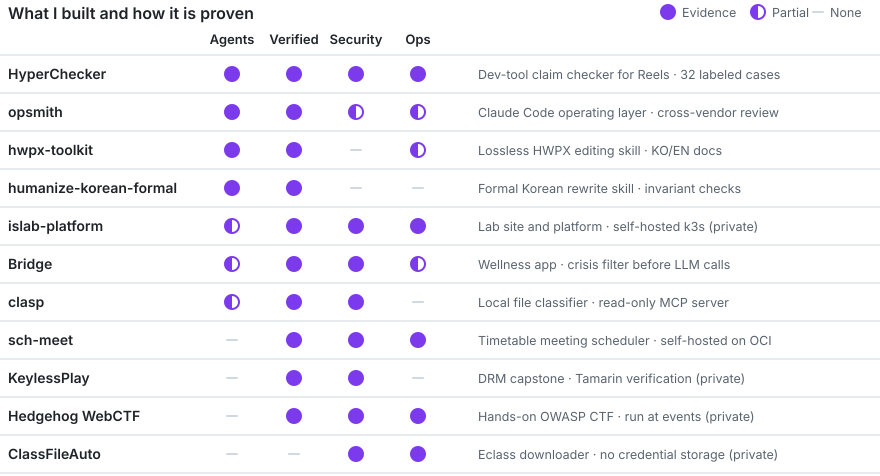
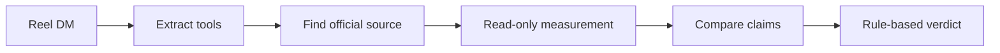

# Jonggun Kim

**AI Agent & MCP Engineer — I build robust AI agents for security domains**

[한국어](./README.md) · **English**

 

View as a table

| Project | Agents | Verified | Security | Ops |
|---|---|---|---|---|
| HyperChecker | Evidence | Evidence | Evidence | Evidence |
| opsmith | Evidence | Evidence | Partial | Partial |
| hwpx-toolkit | Evidence | Evidence | None | Partial |
| humanize-korean-formal | Evidence | Evidence | None | None |
| islab-platform | Partial | Evidence | Evidence | Evidence |
| Bridge | Partial | Evidence | Evidence | Partial |
| KeylessPlay | None | Evidence | Evidence | None |
| Hedgehog WebCTF | None | Evidence | Evidence | Evidence |
| ClassFileAuto | None | None | Evidence | Evidence |

## Flagship: HyperChecker

Send an Instagram Reel by DM, and this agent checks the developer tools it mentions against public sources and replies.

- **Verification:** Evaluated on 32 human-labeled cases with a holdout set. The limits are published with the results.
- **Guardrails:** Posts are isolated as untrusted input, and the tools under review are never executed.
- **Operations:** Runs as a public service. Real reply logs drove later fixes.

[Repository](https://github.com/KimHands/hype-checker) · [@hyper_checker](https://www.instagram.com/hyper_checker/)

## More work

| Area | Projects |
|---|---|
| Agent tooling | [opsmith](https://github.com/KimHands/opsmith) · [hwpx-toolkit](https://github.com/KimHands/hwpx-toolkit) · [humanize-korean-formal](https://github.com/KimHands/humanize-korean-formal) |
| Services | [Bridge](https://github.com/KimHands/bridge) · [SCH-Meet](https://github.com/KimHands/SCH-Meet) · islab-platform (private) |
| Security | KeylessPlay (private) · [Hedgehog WebCTF](https://hedgehog-server.tail53c7cd.ts.net:10000/) · [ClassFileAuto](https://class-file-auto-web.vercel.app) |

## Experience

- DRM security research with Tamarin formal verification (CISC-S'26 accepted)
- [AX CIC] Education Team Intern at Wrtn: authored AI/AX bootcamp curriculum
- Full-stack track lead at Likelion SCH, 14th cohort
- CSE at Soonchunhyang University (3rd year), security research at SCH Hedgehog

## Stack

