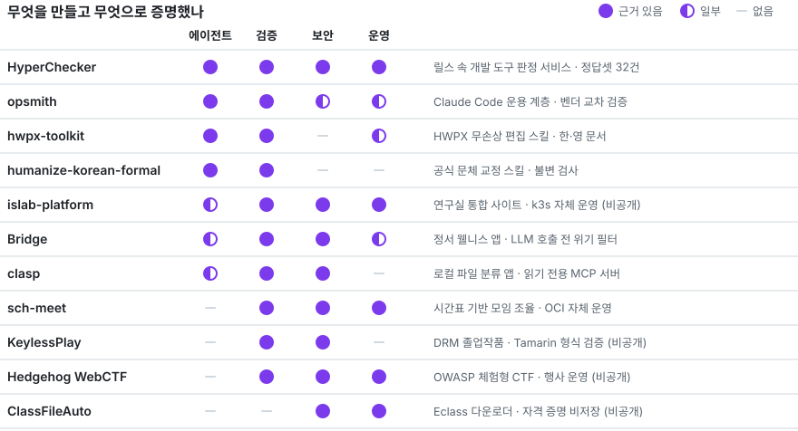
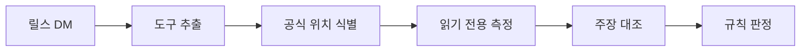

# 김종건 · Jonggun Kim

**보안 도메인에서 동작하는 견고한 AI 에이전트·MCP 개발자**

**한국어** · [English](./README.en.md)

 

## 대표작: HyperChecker

인스타그램 릴스를 DM으로 보내면, 소개된 개발 도구를 공개 자료로 확인해 답장하는 에이전트입니다.

- **검증:** 사람이 판정한 정답셋 32건과 홀드아웃으로 평가하고, 한계까지 함께 공개합니다.
- **가드레일:** 게시물은 신뢰하지 않는 입력으로 격리하고, 판정 대상은 실행하지 않습니다.
- **운영:** 공개 서비스로 운영하며, 실제 답장 로그로 찾은 문제를 고쳤습니다.

[레포](https://github.com/KimHands/hype-checker) · [@hyper_checker](https://www.instagram.com/hyper_checker/)

## 그 외

| 분야 | 프로젝트 |
|---|---|
| 에이전트 도구 | [opsmith](https://github.com/KimHands/opsmith) · [hwpx-toolkit](https://github.com/KimHands/hwpx-toolkit) · [humanize-korean-formal](https://github.com/KimHands/humanize-korean-formal) |
| 서비스 | [Bridge](https://github.com/KimHands/bridge) · [sch-meet](https://github.com/KimHands/sch-meet) · [clasp](https://github.com/KimHands/clasp) · [islab-platform](https://isl-hedgehog.com/) |
| 보안 | KeylessPlay (비공개) · [Hedgehog WebCTF](https://hedgehog-server.tail53c7cd.ts.net:10000/) · [ClassFileAuto](https://class-file-auto-web.vercel.app) |

## 활동

- DRM 보안 연구: Tamarin 형식 검증 (CISC-S'26 채택)
- 뤼튼 [AX CIC] 교육팀 인턴: AI·AX 부트캠프 교안 제작
- 멋쟁이사자처럼 순천향대 14기 풀스택 파트장
- 순천향대 컴퓨터소프트웨어공학과 4학년 · Hedgehog 보안 연구

## 기술 스택

